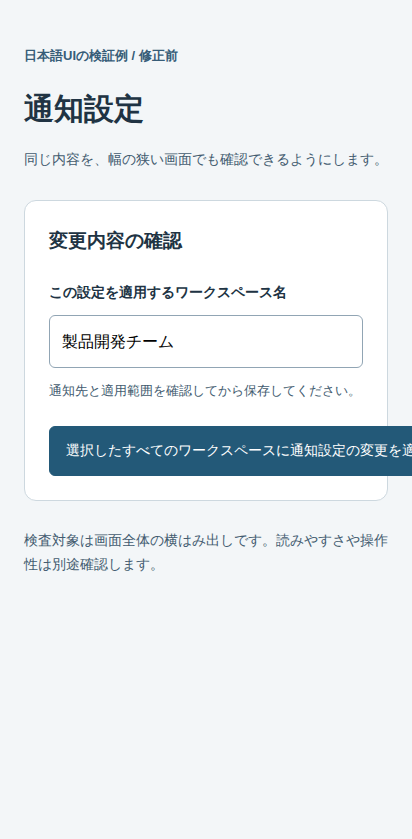
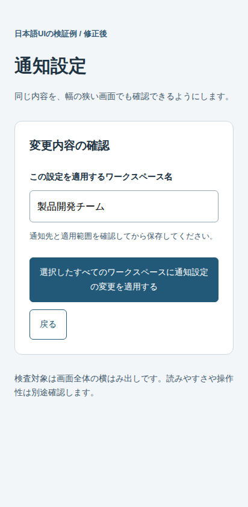

# jp-ui-contracts

Japanese UI design contracts and focused browser checks for AI-assisted development.

**AIで作る日本語UIのルールをDESIGN.mdに残し、生成した画面の崩れを確かめるためのキットです。**

長い日本語ラベル、和欧混植、フォーム、表、モバイル幅を扱います。用途別の契約テンプレートに加え、検証用の画面、目視レビューの基準、自分のローカル画面を検査するコマンドを用意しています。

## まず、一つの崩れを見つける

幅412pxの通知設定画面です。長い日本語ラベルを折り返さずに並べると、画面が横へ広がります。同じ内容・文字サイズのまま、ボタンとその配置を折り返すと収まります。

| 修正前：横にはみ出す | 修正後：同じ内容が収まる |
|---|---|
|  |  |
| clientWidth **412px** / scrollWidth **549px** → **FAIL** | clientWidth **412px** / scrollWidth **412px** → **PASS** |

[測定記録と出典](docs/images/overflow-measurements.json)：2026年11月1日、Chromium 156.0.8078.4、412 × 839 CSS px。フォントや実行環境が変わると測定値も変わるため、数値を合格基準として固定しません。

この例は導入用に作成した合成例です。AIの生成品質や改善率を比較した実験ではありません。画像はPlaywrightで取得し、測定結果と対応させています。

修正の中心は、配置と文言の折り返しです。

```css
.actions { flex-wrap: wrap; }
.action {
  white-space: normal;
  min-width: 0;
  max-width: 100%;
  overflow-wrap: anywhere;
}
```

文字を小さくしたり、内容を隠したりせずに修正します。[修正前後のHTMLと検出テスト](examples/overflow-walkthrough/README.md)を確認できます。

## 試す

Git・Node.js 22・Python 3.12を使う手順です。以下は現在のmain向けで、公開済みv0.2.0には新しい`check:ui`コマンドは含まれません。

```bash
git clone https://github.com/hirokaji/jp-ui-contracts.git
cd jp-ui-contracts
npm install --ignore-scripts --no-audit --no-fund
npx playwright install chromium
python -m http.server 8000 --bind 127.0.0.1
```

サーバーを動かしたまま別のターミナルを開き、同じリポジトリのルートで次を一つずつ実行します。

```bash
npm run check:ui -- --url http://127.0.0.1:8000/examples/overflow-walkthrough/before.html
npm run check:ui -- --url http://127.0.0.1:8000/examples/overflow-walkthrough/after.html
```

修正前は**FAIL（終了コード1）**、修正後は**PASS（終了コード0）**が期待結果です。`ui-evidence/run-*/`にJSONレポートと画像が残ります。ERROR（終了コード2）は検査未成立です。最初のFAILで止まるため、二つのコマンドを`&&`でつながないでください。

Windows、Linuxの依存関係、結果の読み方、失敗時の対処を含む[最初からの導入手順](docs/getting-started.md)があります。

## 自分の案件で使う

1. 用途に合う`templates/`のDESIGN.mdを、自分のアプリへコピーする。
2. 利用者、用途、文字・配置の方針、確認する画面と状態を記入する。
3. コーディングエージェントへDESIGN.mdを渡して実装・修正する。
4. アプリをローカルで起動し、そのURLを指定して検査する。
5. 読みやすさ・内容の欠け・IMEなどを目視確認し、問題の原因に応じて実装や契約へ戻す。

例えばアプリがポート3000で動いている場合、検査ツール側のリポジトリで実行します。

```bash
npm run check:ui -- --url http://127.0.0.1:3000/settings --width 412
npm run check:ui -- --url http://127.0.0.1:3000/settings --width 1440
```

URLは実際の画面へ置き換えてください。SPAでは`--ready-selector`で目的画面の準備完了を待てます。新規ブラウザを使うので、普段のログイン状態は引き継ぎません。

コピーするファイル、AIへの依頼文、契約ファイルの検査、画面の検査を[導入手順](docs/getting-started.md#4-自分の案件の契約を作る)で説明しています。

## PASSの範囲

| 検査 | 対象 | 分かること |
|---|---|---|
| `python validators/contract.py validate ...` | DESIGN.md | 必須情報や一部の禁止CSSが静的チェックを満たすか |
| `npm run test:rendered` | このリポジトリのfixtureと回帰例 | 定義した画面と条件で、検査が期待どおりに働くか |
| `npm run check:ui -- --url ...` | 自分で指定したローカル画面 | 指定幅で文書全体が横にはみ出していないか |

**契約ファイルのPASS、リポジトリのCI成功、利用者の画面のPASSは、それぞれ別の結果です。**

`check:ui`はDESIGN.mdの文字サイズや行間を自動照合しません。`overflow: hidden`で部品の内容を切り落とした画面も、文書が横に広がらなければPASSになります。美的品質、IME操作、アクセシビリティ全般、Firefox / WebKit、実機での適合も、この結果だけでは保証しません。

自動検査と手動確認の対応、終了コード、Evidence、反例は[検証範囲](docs/validation-coverage.md)を参照してください。

## 用途別テンプレート

| Profile | 主な用途 | 重視すること |
|---|---|---|
| [base](templates/base/DESIGN.md) | 共通項目から設計する | 日本語の文字・改行・部品・検証条件 |
| [media](templates/media/DESIGN.md) | 記事、ブログ | 長文を読むリズム |
| [saas](templates/saas/DESIGN.md) | 管理画面、設定画面 | ラベル、フォーム、安定した密度 |
| [docs](templates/docs/DESIGN.md) | 技術文書、ヘルプ | 本文・コード・表の共存 |
| [dashboard](templates/dashboard/DESIGN.md) | KPI、監視画面 | 数値・表の走査性 |

迷う場合は[profile selector](docs/profile-selector.md)を使えます。各profileへbaseの全項目が自動継承される仕組みはありません。必要な規則を選び、自分のDESIGN.mdへまとめてください。

## 提供する部品

- [CSS recipes](recipes/)：日本語本文、見出し、和欧混植、フォームのCSS断片
- [7種類のfixture](fixtures/fixture-matrix.md)：長文、混植見出し、長いURL、フォーム、表、モバイル幅、技術文書
- [Scorecard](validators/scorecard.md)：目視でPASS / WARN / FAILを判断する観点
- [Agent Skill](skills/japanese-ui-contract-review/SKILL.md)：契約を読み、検証し、原因のある層を修正する手順。利用するエージェントへの適応が必要です。
- [Examples](examples/)：設計例と、失敗・修正の実行例

DESIGN.mdは人間が編集する契約です。機械処理に必要なら、メタデータと検証項目をJSONへ出力できます。

```bash
python validators/contract.py export ../my-app/DESIGN.md -o design-contract.json
```

このJSONは生成物であり、別途手で編集する契約にはしません。契約全体を実行可能に変換するものでもありません。

## 開発・保守

PR、mainへの変更、週次スケジュールで契約検証とブラウザテストを実行します。既存fixtureはデスクトップとPixel 7設定のChromiumで検査し、新しいCLIの回帰テストはデスクトップChromiumを指定幅に変更して実行します。

CIの`rendered-validation-evidence`には画像、JSONメトリクス、HTMLレポート、失敗時のtraceが含まれます。保存期間は14日です。READMEの比較画像と測定記録は`docs/images/`へ保存しています。

- [コントリビューション](CONTRIBUTING.md)
- [保守の進め方](docs/maintenance.md)
- [設計思想](docs/philosophy.md)
- [変更履歴](CHANGELOG.md)

## 公開バージョン

最新の公開リリースは[v0.2.0 — executable contract validation](https://github.com/hirokaji/jp-ui-contracts/releases/tag/v0.2.0)です。タグ対象は`ba4f44c65b18c27ba784d9171a80859f798c5c89`で、公開記録は維持しています。

今回の導入改善とローカルURL検査はmain上のUnreleasedです。[v0.2.0公開時の合格条件](docs/v0.2-release-gate.md)と、現在追加されている機能の範囲を区別してください。

## License

MIT
